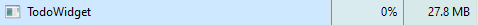

# To-Do

A modern, ultra-lightweight desktop to-do list widget, focus suite, and task organizer for Windows.

I built this app with a single goal in mind: killing procrastination. I often found myself getting distracted on my PC and completely forgetting what I actually sat down to do. This app sits on your desktop, keeps your tasks right in front of you, and reminds you when things are due so you stay on track.

No Chromium, no Electron, and no background memory hogging. It is built natively with C# and WPF on .NET 8.

---

## Performance & System Impact

Unlike modern productivity tools that consume hundreds of megabytes of RAM running headless browsers, To-Do is written in pure C# WPF. It runs quietly in the background with virtually zero impact on your system.



- Idle CPU Usage: 0%
- Memory Footprint: ~27.8 MB RAM
- Zero Background Telemetry or Bloat

---

## What's New in 5.0.0 (Major Release: App Blocker & Deep Focus)

- Active Distraction App Blocking: Configure designated distraction applications that will be automatically blocked while Focus Mode is running. The background monitor safely terminates blocked programs immediately upon launch so you stay in the flow.
- Comprehensive System App Scanner: Scans Start Menu shortcuts (all users and current user), 32-bit and 64-bit Windows Registry paths, and running processes to discover all installed applications with their extracted icons for one-click blocking.
- Drag-and-Drop & File Picker Import: Drag and drop any executable file (.exe) or desktop shortcut (.lnk) directly into the dashboard, or use the file browser to add custom apps to your block list.
- One-Click Distraction Presets: Pre-configured quick-add buttons for the most common productivity drains including Google Chrome, Microsoft Edge, Discord, Spotify, Steam, Epic Games, Telegram, WhatsApp, Firefox, and Riot Client.
- Anti-Cheat Task Manager Protection: Prevents opening Windows Task Manager while Focus Mode is active, neutralizing attempts to prematurely kill To-Do before your focus session concludes.
- Strict Focus Lock: Optional session locking that guards application exit from the system tray until Focus Mode is turned off.
- 100% Non-Destructive Architecture: Pure in-memory process monitoring with zero registry pollution, zero file permission modifications, and zero risk of permanently breaking apps. The moment Focus Mode ends, all applications immediately launch normally.

---

## What's New in 4.2.0 (UI Fixes & Bug Fixes)

- Action Button Visibility Restored: Fixed a critical layout clipping bug where inherited button padding compressed small action buttons (edit, delete, voice note, refresh) down to zero width. Buttons now feature dedicated styling with distinct borders, centered glyphs, and responsive hover highlights.
- Prevented Completed Tasks from Reappearing: Resolved an issue where completing a task could cause it to reappear as a new pending task during cloud sync. Fixed LiteDB `ObjectId` serialization across devices, added strict completion-state precedence, and implemented self-healing database de-duplication.
- Widget Action Controls: Upgraded desktop widget task buttons with clean dark containers, subtle borders, and clear hover feedback.

---

## What's New in 4.1.0 (Bug Fix Release)

- Fixed Instant Startup Crash: Resolved a XAML initialization exception (invalid MultiBinding markup) on the desktop widget's daily progress bar that caused the application to terminate immediately upon launch.
- Window State Hardening: Added defensive safeguards preventing illegal visibility updates during window close and move transitions.
- Global Crash Diagnostics: Integrated automatic crash logging to `%LOCALAPPDATA%\TodoWidget\crash.log` to ensure maximum runtime resilience.

---

## What's New in 4.0.0 (Major Release)

- Complete UI Overhaul: Re-engineered with a modern Obsidian Glass design, refined navigation rails, smooth micro-interactions, and fluid transitions that can be toggled on or off in Settings.
- GitHub Cloud Sync (Account System): Connect using a personal access token to automatically sync your tasks, daily streaks, and preferences across all your Windows devices via a secure private GitHub Gist.
- Daily Completion Progress Bar: An integrated animated progress bar embedded directly below the widget header, calculating your real-time daily progress with color transitions upon hitting 100%.
- Anti-Procrastination Focus Mode: A dedicated single-task view mode that eliminates distraction by collapsing your task list and presenting only the next critical priority task.
- 2-Minute Kickstart & Pomodoro Timers: Overcome task initiation inertia with an integrated 120-second Kickstart countdown sprint or run focused 25-minute Pomodoro sessions.
- Silent Auto-Update & Restart: When updating inside the app, the installer downloads and installs seamlessly in the background without opening the setup wizard, then restarts the new version automatically.

---

## Key Features

- Desktop Widget: A compact widget that lives right on your desktop. You can pin it directly behind all open windows like interactive wallpaper, or let it float comfortably on top.
- Interactive Desktop Pinning: Click, check tasks, and play voice notes directly from your desktop even while pinned behind other windows.
- GitHub Account Sync: Two-way cloud synchronization across all your computers with zero external server dependencies.
- Recurring Schedules: Set up tasks that repeat on chosen days of the week with custom start and end times in 12-hour AM/PM format.
- Voice Notes: Record and attach audio memos to any task. Listen to them right from the dashboard or directly from the desktop widget.
- Widget Appearance & Themes: Customize widget background colors, opacity, corner radius, fonts, and dimensions to blend into your desktop wallpaper.
- Configurable Animations: Smooth transitions and visual feedback that can be enabled or disabled with a single toggle in Settings.
- Smart Reminders: Native Windows notifications alert you before tasks are due, with one-click snooze and completion actions.
- Daily Streaks: Complete all scheduled tasks before midnight to build your daily streak.
- In-App Auto Updates: Seamlessly check for new GitHub releases, install updates silently, and restart automatically.

---

## How to Use It

1. Quick Adding Tasks
   - Type your task title directly into the input bar at the bottom of the widget and press Enter.
   - For recurring schedules, AM/PM times, priorities, or voice notes, open the dashboard and click "+ New Task".

2. Anti-Procrastination Focus Mode & Sprint Timer
   - Click the target icon on the widget header to switch into Focus Mode.
   - The widget focuses on your top-priority pending task and opens the sprint timer.
   - Click "2m" for a 120-second initiation kickstart sprint or "25m" for a Pomodoro session, then press Play.
   - Mark the task done with one click when finished!

3. GitHub Cloud Sync
   - Open the Dashboard and navigate to the "Account & Sync" tab.
   - Enter a GitHub Personal Access Token (classic) with the `gist` permission.
   - Click "Connect & Sync Account" to link your account and enable automatic cloud backup.

4. Recurring Tasks & Time Entry
   - In the task editor, check "Recurring Schedule" to pick days (e.g. Mon / Wed / Fri).
   - Use the dropdown or type your start and end times in standard format (e.g. 9:00 AM, 2:30 PM).

5. Recording Voice Notes
   - While creating or editing a task, click "Record Voice Note" to speak your notes.
   - Preview your audio note and save. Play it back directly from the widget or dashboard.

6. Widget Placement & Docking
   - Drag the widget anywhere by clicking and holding the top bar.
   - Open Settings to dock the widget to preset corners (Top-Right, Top-Left, Bottom-Right, Bottom-Left, Center-Right) or customize its dimensions.
   - Choose between "Float Always on Top" and "Pin Directly to Desktop".

7. Silent Auto-Update
   - When a new update is released, you will be prompted directly in the Dashboard.
   - Click "Download & Install Silently" to let the app update and relaunch seamlessly in the background.

8. System Tray
   - Closing the dashboard minimizes the app to your Windows system tray with its custom icon.
   - Right-click the tray icon to quickly reopen the dashboard, toggle widget visibility, or exit.

---

## Installation

### Option 1: Standalone Installer (Recommended)
1. Head over to the Releases section on GitHub.
2. Download `ToDoSetup-4.0.0.exe`.
3. Run the installer and follow the on-screen steps. It creates desktop shortcuts, start menu entries, and registers the system tray companion.

### Option 2: Building from Source
Requirements:
- Windows 10 (Version 2004 / Build 19041 or higher) or Windows 11
- .NET 8.0 SDK

Steps:
1. Clone the repository:
   ```bash
   git clone https://github.com/Kartik-181123/To-Do-App.git
   cd To-Do-App
   ```

2. Build and run:
   ```bash
   dotnet run --project src/TodoWidget/TodoWidget.csproj
   ```

3. Or publish a self-contained release build:
   ```powershell
   powershell -ExecutionPolicy Bypass -File .\build.ps1
   ```

---

## About the Author

Hey, I am Kartik. I built this app to solve my own procrastination habits while pair-programming and learning desktop application development with C#. If this app helps you stay productive, feel free to star the repository or report feedback in the Issues tab.

GitHub: https://github.com/Kartik-048
